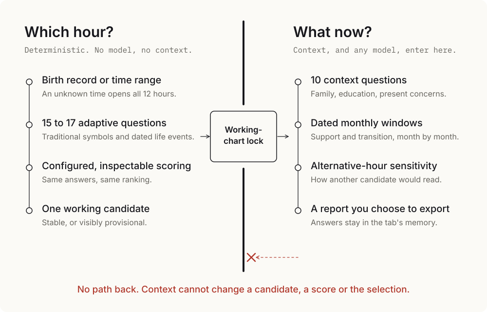
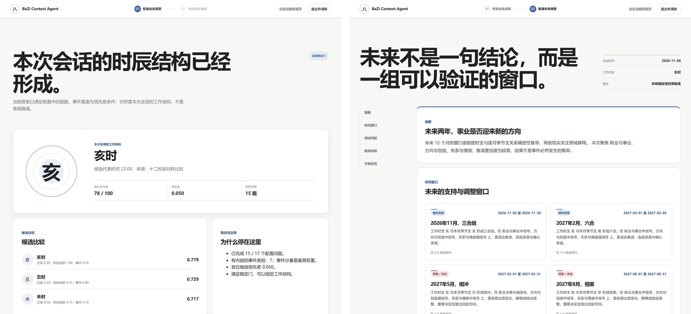

# BaZi Context Agent

**Which hour were you born, and what is happening in your life now? I built a system where the second answer can never change the first.**

**[Open the experience](https://www.theodoreoy.com/bazi-context-agent/)** · [中文](docs/README.zh-CN.md)

When an uncertain birth hour is settled by someone who already knows your story, the story can quietly choose the hour that fits it. I made that contamination structurally impossible. The comparison of birth hours runs as deterministic code and locks before the first question about your present life is asked.

## The Idea

A chart describes how a life tends to move. It cannot say where that life stands today. That is the structure of a differential equation, so I built the system as one.

| | In mathematics | In this system |
|---|---|---|
| **Derivative** | How the state changes | BaZi variables and their derived structure |
| **Initial value** | Where the state begins | Real-world context the person controls |
| **Solution** | The trajectory from that start | A forecast at a given date and horizon |

The separation is the contribution. A derivative without an initial value is generic, and an initial value allowed to edit the derivative would be fitting its own answer.

## Why It Is Built This Way

**Ranking is code, never a model.** The same answers and configuration always produce the same ranking. Every question lives in one configuration file and every weight in another, so the whole method can be read and challenged line by line. Dated life events carry 55% of the score, symbolic priors 25%, and the birth record 20%.

**An unknown time stays unknown.** A missing birth time opens all twelve hour branches symmetrically, with no arbitrary default.

**Confidence is earned and shown.** The adaptive sequence stops between 15 and 17 questions, once the leading margin and event coverage clear a configured gate. A candidate that falls short locks as visibly provisional, and even a stable lock is presented as a working structure for the session, never as objective truth.

**Context has no way back.** After the lock, context shapes interpretation only. Tests enforce this at the engine, the server, and the source level.

**Models arrive last.** The public ranking and report run entirely in the browser without calling a model. In the local research pipeline, optional providers join only after the lock.

**The answers stay with the person.** The public experience has no account, no API key, and no backend. The session lives in the tab's memory until the person chooses to export it.

*The ranking and the report, from a session with sample answers. Monthly windows are derived deterministically from the locked hour branch and seasonal branches mapped to Gregorian months.*

## How It Is Measured

I built an offline harness that isolates what each input contributes.

| Mode | Chart | Context | Against D, it shows |
|---|---|---|---|
| **A** | Selected | None | What context adds |
| **B** | None | Supplied | What the chart adds |
| **C** | Recorded time | Supplied | What rectification adds |
| **D** | Selected | Supplied | The full system |

Holdout construction and temporal filtering keep known facts out of each prediction, and a leakage guard penalizes any mode whose input already contains its target, so recall cannot pass for forecasting. Any claim about accuracy has to be earned through this harness.

## The Engineering

**146 automated tests** cover deterministic scoring, context isolation, API contracts, report generation, session controls, and provider boundaries. Strict types, generated-config parity, and static security checks form the release gate. One interface serves GitHub Pages, the local preview, and the API server, with no third-party runtime dependency, and its welcome and report states pass at **nine viewport sizes from 320 to 1920 pixels wide**.

[Architecture](docs/ARCHITECTURE.md) · [Validation](docs/VALIDATION.md) · [Evaluation design](docs/EVALUATION.md) · [Privacy](docs/PRIVACY.md) · [Deterministic engine](site/core/rectification.js) · [Ranking invariants](tests/noAiBoundary.test.ts)
