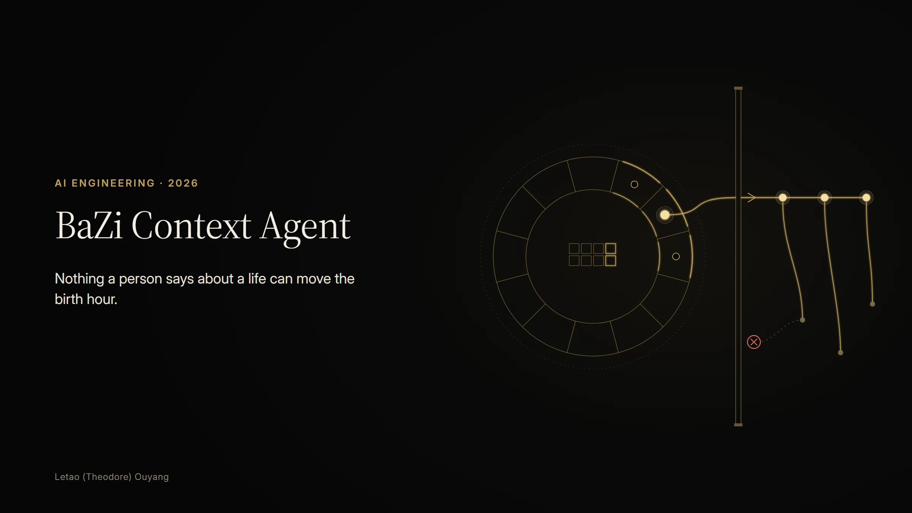
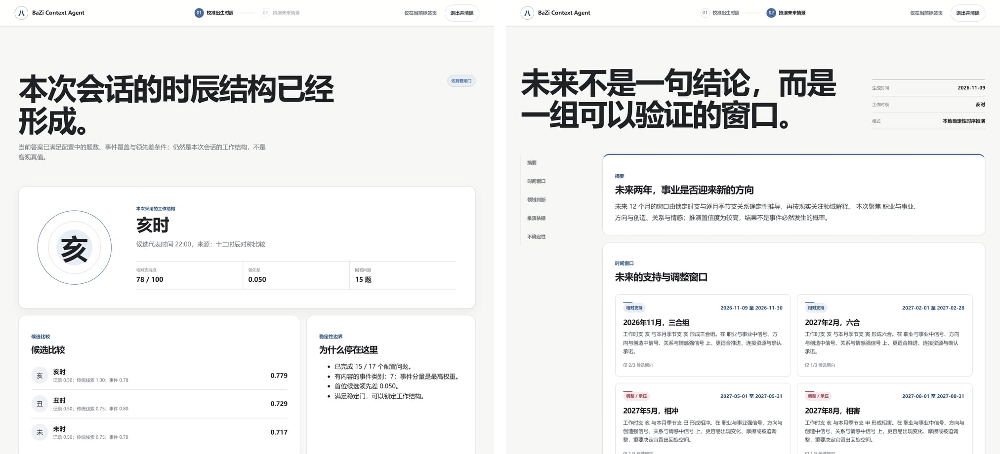
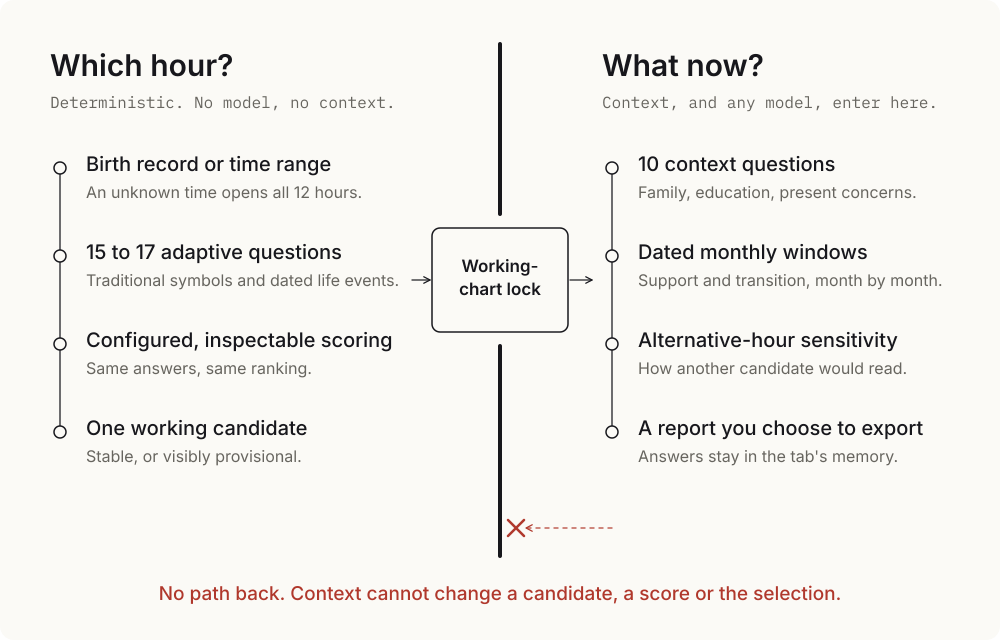
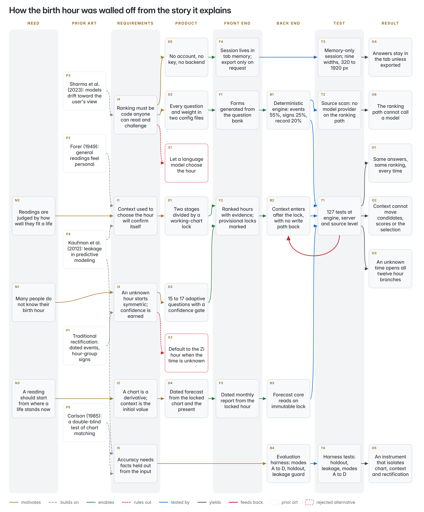

# BaZi Context Agent

**Letao (Theodore) Ouyang** · Product, front end, back end and tests · June – August 2026

[Open the app](https://www.theodoreoy.com/ENGINEERING-BaZi-Context-Agent/) · [Engineering route](docs/engineering-route.md) · [Prior art](docs/prior-art.md) · [Architecture](docs/ARCHITECTURE.md) · [Evaluation](docs/EVALUATION.md)

**Which hour was a person born, and what is happening in that life now? I built a system in which the second answer can never change the first.**

Many people do not know their birth hour, and a BaZi reading depends on it. The usual way to settle it is to hear the
person's story and pick the hour that fits, which guarantees that the reading will fit the story for the wrong reason.
I made that contamination structurally impossible. The comparison of birth hours runs as deterministic code over
dated life events, hour-group signs and the birth record, and it locks a working chart before the first question
about the person's present life is asked. Context then shapes the forecast and has no path back to candidates,
scores or the selection. The public app runs entirely in the browser with **no account, no key and no backend**, and
**127 tests** hold the wall at the engine, the server and the source level.

## Three results to start with

| Result | Why it matters | Where |
| --- | --- | --- |
| Context cannot move candidates, scores or the selection; the ranking contract reports how many context facts were used for ranking, and tests pin that number at zero | A reading is judged by how well it fits a life, so nothing may manufacture fit | [Ranking engine](site/core/rectification.js) · [server tests](tests/server.test.ts) |
| No model can reach the ranking: tests read the ranking path and fail on any provider import | Models drift toward what the user believes; the ranking has to be code anyone can read | [Boundary test](tests/noAiBoundary.test.ts) · [weights](configs/scoring_weights.json) |
| An evaluation harness separates what the chart, the context and rectification each add, on facts the system was never shown | Any accuracy question has an instrument with leakage removed by construction | [Leakage guard](src/leakageGuard.ts) · [evaluation](docs/EVALUATION.md) |

## The problem

A birth record often gives the day but not the hour, and the hour pillar is a quarter of the chart. Traditional
rectification tests candidate hours against dated life events and against signs associated with the three hour
groups. The evidence is sound. The procedure is not: the person who hears the life story also chooses the hour, by
weights no one can see.

Three findings make that a design problem rather than a matter of skill. Generic readings already feel personal
(Forer, 1949). Information about the answer that reaches the input turns any measured accuracy into an artifact
(Kaufman et al., 2012). And language models trained on human preferences tend to agree with the user (Sharma et al.,
2023), so an AI that picks the hour picks the one the person hopes for. [Prior art](docs/prior-art.md) sets out each.

## The idea

A chart describes how a life tends to move. It cannot say where that life stands today. That is the structure of a
differential equation, so I built the system as one.

| | In mathematics | In this system |
| --- | --- | --- |
| **Derivative** | How the state changes | BaZi variables and their derived structure |
| **Initial value** | Where the state begins | The real-world context the person controls |
| **Solution** | The trajectory from that start | A forecast at a given date and horizon |

The separation is the contribution. A derivative without an initial value is generic, and an initial value allowed
to edit the derivative would be fitting its own answer.

## The design

| Layer | What I built | What it buys |
| --- | --- | --- |
| Product | Two stages divided by a working-chart lock; 15 to 17 adaptive questions that stop when the leading margin and event coverage clear a gate; a provisional lock shown as provisional; a symmetric twelve-branch start when the time is unknown; no account, key or backend | The hour is settled before the story is heard, and confidence is earned and shown |
| Front end | Forms rendered from the question bank; the ranked hours with their evidence before any context question; a dated monthly report over 6, 12 or 24 months; the session held in tab memory and exported only on request; values rendered as text under a strict content security policy | The questions on screen are the questions the engine scores, and answers stay with the person |
| Back end | A deterministic engine that weighs dated events at 55%, hour-group signs at 25% and the birth record at 20%, with every weight in configuration and fail-closed scoring; a forecast core that reads an immutable lock; a research API in which optional model providers join only after the lock; an evaluation harness | Same answers, same ranking, every time; models arrive last |
| Tests | 127 tests with strict types, generated-config parity and static security checks as the release gate; welcome and report states checked at nine widths from 320 to 1920 pixels | The wall, the determinism and the privacy rules are enforced on every change |

One interface serves GitHub Pages, the local preview and the API server, with no third-party runtime dependency.
Actions are pinned to full commit hashes and run with least-privilege permissions.

## How it is measured

| Mode | Chart | Context | Against D, it shows |
| --- | --- | --- | --- |
| **A** | Selected | None | What context adds |
| **B** | None | Supplied | What the chart adds |
| **C** | Recorded time | Supplied | What rectification adds |
| **D** | Selected | Supplied | The full system |

Holdout construction removes target facts and later events from every mode's input, and a leakage guard penalizes
any mode whose input already contains its target, so recall cannot pass for forecasting.

## What is new

1. **A temporal wall between the hour and the story.** Rectification and context are separated in time, and the
   separation is tested at the engine, the server and the source level.
2. **Rectification as readable configuration.** Traditional evidence types, written as questions and weights in two
   files that anyone can read and challenge line by line.
3. **Earned confidence.** An adaptive stop at a margin and coverage gate, and a lock that says how sure it is.
4. **A chart as a derivative.** Forecasts are solutions from the person's present, at a chosen date and horizon.
5. **An instrument before any claim.** Four modes, holdout construction and a leakage guard, in the spirit of
   Carlson's double-blind test.

The sibling project [Divination and Destiny Studies](https://github.com/130U/ENGINEERING-Divination-and-Destiny-Studies)
takes the opposite design position and lets a language model compare candidates under strict evidence rules.

## How it was built

<picture>
  <source media="(prefers-color-scheme: dark)" srcset="assets/route-dark.png">
  
</picture>

The route runs from need to result, and one test went back and changed the design.

- **The wall.** Fit is the test readers apply, so the story may not reach the hour. A server test found context
  accepted at the ranking endpoint; the contract was changed to report how many context facts were used for ranking,
  and that number is pinned at zero.
- **Ranking as code.** A model's ranking can be neither repeated nor challenged, so ranking is configuration and
  deterministic code, and no model can be imported on its path.
- **Honest uncertainty.** An unknown time starts symmetric, and a lock says whether it cleared the confidence gate.
- **The chart as a derivative.** The forecast starts from where the person stands and never edits the chart.
- **An instrument before any claim.** Four modes and a leakage guard measure what each input adds.

The [engineering route](docs/engineering-route.md) explains all 38 steps and all 38 links.

## Repository

| Path | Contents |
| --- | --- |
| [`docs/engineering-route.md`](docs/engineering-route.md) · [`docs/prior-art.md`](docs/prior-art.md) | The route as a network, and the prior art |
| [`docs/ARCHITECTURE.md`](docs/ARCHITECTURE.md) · [`docs/SCORING_SPEC.md`](docs/SCORING_SPEC.md) · [`docs/EVALUATION.md`](docs/EVALUATION.md) · [`docs/PRIVACY.md`](docs/PRIVACY.md) | Architecture, scoring, evaluation and privacy |
| [`site/`](site/) | The public app: deterministic core, interface modules and runtime configuration |
| [`src/`](src/) | TypeScript engine, research API server, forecast and evaluation harness |
| [`configs/`](configs/) | The question bank and the scoring weights |
| [`tests/`](tests/) | The test suite |

## Citation

Letao (Theodore) Ouyang, *BaZi Context Agent* (2026), <https://www.theodoreoy.com/ENGINEERING-BaZi-Context-Agent/>.
See [CITATION.cff](CITATION.cff).

[theodore.oy2025@gmail.com](mailto:theodore.oy2025@gmail.com) · [10@alumni.duke.edu](mailto:10@alumni.duke.edu)

© Letao (Theodore) Ouyang. All rights reserved.
