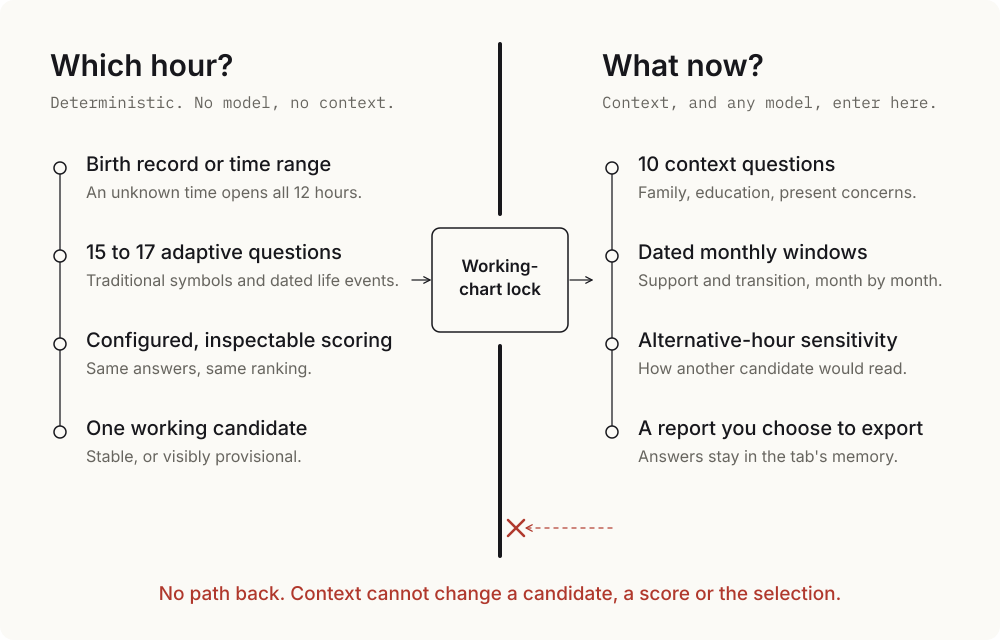
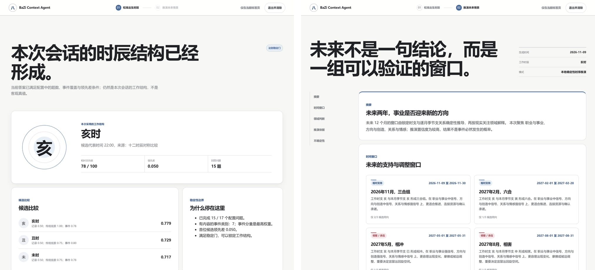

# 八字 Context Agent

**你生在哪个时辰？你现在的生活正在发生什么？我构建的这套系统，让第二个答案永远改变不了第一个。**

**[打开体验](https://www.theodoreoy.com/bazi-context-agent/)** · [English](README.md)

当一个不确定的出生时辰，由已经知道你人生故事的人来判定时，故事就可能悄悄选中与它相符的时辰。我从结构上杜绝了这种污染：时辰比较全部由确定性代码完成，并在第一个关于你当下生活的问题出现之前锁定。

## 核心思想

命盘描述的是一段人生倾向于如何变化，却无法说明这段人生今天站在哪里。这正是微分方程的结构，于是我按这个结构构建了系统。

| | 数学中 | 系统中 |
|---|---|---|
| **导函数** | 状态如何变化 | 八字变量及其派生结构 |
| **初始值** | 状态从哪里开始 | 由本人掌控的现实情境 |
| **解** | 从起点出发的轨迹 | 给定日期与周期下的推演 |

这种分离正是本项目的贡献。没有初始值，导函数只是泛泛之论；若初始值可以改写导函数，模型拟合的就只是它自己的答案。

## 为什么这样设计

**排序由代码完成，绝不交给模型。** 相同的答案和配置永远得到相同的排序。所有问题来自一份配置文件，所有权重来自另一份，整套方法可以逐行审视和质疑。有明确年份的人生事件占评分的 55%，传统象征线索占 25%，出生记录占 20%。

**未知的时间就保持未知。** 出生时间缺失时，十二时辰对称进入候选，不设任何武断的默认值。

**置信度要靠挣得，并如实呈现。** 自适应问卷在 15 至 17 题之间停止，前提是领先差与事件覆盖度通过配置的稳定门。未达标的候选会被明确标记为暂定；即便稳定锁定，呈现给用户的也只是本次会话的工作结构，而非客观真值。

**情境没有回头路。** 锁定之后，情境只影响解读。引擎、服务端和源码三个层面都有测试守住这条边界。

**模型最后才登场。** 公开版的排序与报告完全在浏览器内运行，不调用任何模型。本地研究管线中的可选模型，也只在锁定之后才接入。

**答案始终属于本人。** 无需账号，无需 API key，没有后端。会话只存在于标签页内存中，由本人决定何时导出。

*排序与报告，使用示例答案生成。逐月窗口由锁定时支与映射到公历月份的季节支确定性推导。*

## 如何度量

我构建了一套离线评测框架，分别隔离每一种输入的贡献。

| 模式 | 命盘 | 情境 | 与 D 对比可见 |
|---|---|---|---|
| **A** | 校准后的命盘 | 无 | 情境的增量 |
| **B** | 无 | 提供 | 命盘的增量 |
| **C** | 记录时间的命盘 | 提供 | 校时的增量 |
| **D** | 校准后的命盘 | 提供 | 完整系统 |

留出集构建与时间过滤让已知事实无法进入预测，泄漏防护会惩罚输入中已包含目标答案的模式，复述因此无法冒充预测。任何关于准确性的主张，都必须先通过这套框架来证明。

## 工程质量

**146 个自动化测试**覆盖确定性评分、情境隔离、API 契约、报告生成、会话控制与模型边界。严格类型检查、生成配置一致性和静态安全检查共同构成发布门禁。GitHub Pages、本地预览和 API 服务共用一套界面，运行时没有第三方依赖，欢迎页与报告页在 **320 到 1920 像素宽的九种视口**下全部通过检查。

[架构](docs/ARCHITECTURE.md) · [评测设计](docs/EVALUATION.md) · [隐私](docs/PRIVACY.md) · [确定性引擎](site/core/rectification.js) · [排序不变性测试](tests/noAiBoundary.test.ts)
