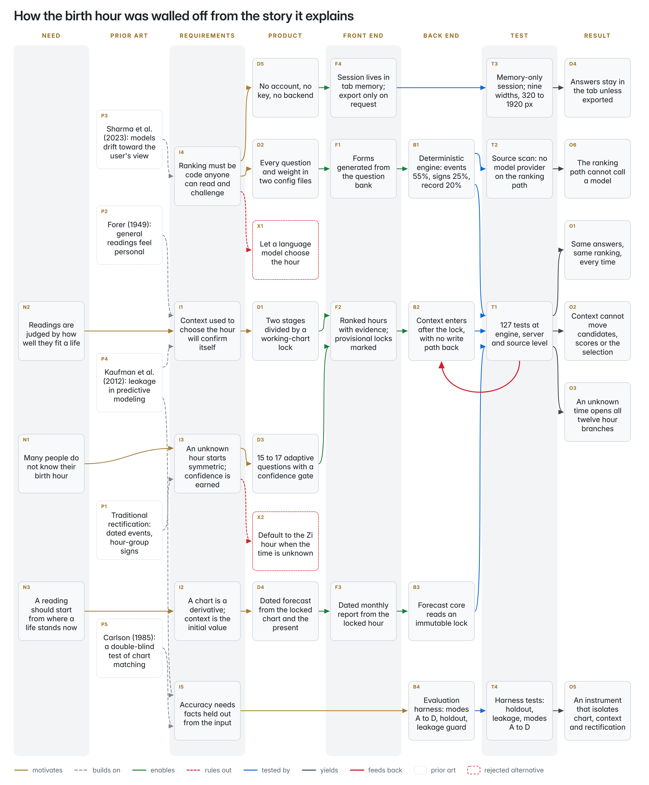

# Engineering route

How the product was built, from the need to the result: which need forced which requirement, what prior work each
decision stands on, how product, front end and back end divide the work, what the tests check, and where a test
went back and changed the design.

<picture>
  <source media="(prefers-color-scheme: dark)" srcset="../assets/route-dark.png">
  
</picture>

## Reading the figure

Columns run from need to result, the order in which a product is reasoned about. A link can run between any two
columns, and one runs backwards, from a test to the design.

| Link | Meaning |
| --- | --- |
| motivates | A need or a requirement that made the next step necessary |
| builds on | Prior work the step starts from |
| enables | A decision that makes a component possible |
| tested by / yields | A component and the suite that checks it; a suite and what it establishes |
| feeds back | A test result that changed the design |
| rules out | A requirement that excludes an alternative |

Solid boxes are my own steps. Dotted boxes are prior art, and red dashed boxes are alternatives I rejected.

## The five threads

### 1. The wall between the hour and the story

N2, P2, P4 → I1 → D1 → F2 → B2 → T1 → O2, with T1 feeding back into B2.

People judge a reading by how well it fits their life (N2). That makes fit the one thing a reading system must not
manufacture. Forer showed in 1949 that a generic description already feels personal (P2); a system that lets the
present story help choose the birth hour makes that effect structural, because the hour it picks will fit the story
by construction (I1). In machine-learning terms it is target leakage (P4): information about the answer reaches the
input that is supposed to predict it.

The only separation that cannot leak is temporal. The product runs in two stages divided by a working-chart lock
(D1): birth-hour comparison runs first and locks, and only then are present-life questions asked. The lock screen
shows the ranked hours and their evidence before any context question appears (F2), and after the lock context can
shape interpretation only (B2). A server test settled how strict the wall must be (T1 → B2): it found context facts
accepted at the ranking endpoint, so the ranking contract reports how many context facts were used for ranking, and
the tests pin that number at zero (O2).

### 2. Ranking as code

P3 → I4 → D2 → F1 → B1 → T1, T2 → O1, O6; I4 → D5 → F4 → T3 → O4; I4 rules out X1.

A language model is the obvious engine for an AI reading product, and the wrong one for ranking (X1). Its answer can
be neither repeated nor argued with, and models trained on human preferences drift toward what the user already
believes (P3). The ranking has to be code anyone can read (I4). Every question lives in one question bank and every
weight in one scoring file, and business logic fails closed when a weight is missing (D2). The forms are rendered
from the same configuration the engine scores (F1). The engine weighs dated life events at 55%, hour-group signs at
25% and the birth record at 20% (B1), and the same answers always give the same ranking (O1). Tests read the source
of the ranking path and fail on any model-provider import (T2 → O6).

Deterministic code also needs no key and no server, so the public experience has no account, no key and no backend
(D5). The session lives in the tab's memory and leaves it only through an explicit export (F4, T3 → O4).

### 3. Honest uncertainty

N1, P1 → I3 → D3 → F2, with I3 ruling out X2.

The uncertain hour is the normal case (N1), and traditional rectification already names the evidence that settles
it: dated life events and the signs associated with the three hour groups (P1). Two rules follow (I3). An unknown
time opens all twelve hour branches symmetrically, so no hour is preferred by default (X2 rejected, O3). And
confidence is earned: the adaptive sequence asks 15 to 17 questions and stops when the leading margin and the event
coverage clear a configured gate (D3). A lock that falls short is shown as provisional, and every lock is presented
as the working structure of the session.

### 4. The chart as a derivative

N3 → I2 → D4 → F3 → B3.

A chart describes how a life tends to move; it cannot say where a life stands today (N3). That is the structure of a
differential equation (I2): the chart is the derivative, the person's present is the initial value, and a forecast
is the solution at a given date and horizon (D4). The separation is the contribution. A derivative without an
initial value is generic, and an initial value allowed to edit the derivative would be fitting its own answer. The
report lays out dated monthly windows over a horizon of 6, 12 or 24 months (F3), computed by a forecast core that
accepts any horizon from 1 to 36 months, reads the lock and cannot alter it (B3).

### 5. An instrument before any claim

P4, P5 → I5 → B4 → T4 → O5.

A forecast can only be scored against facts it was never given, with time respected (I5). Carlson's double-blind
test (P5) judged readings against facts the reader never saw; leakage research (P4) says the separation has to be
built into the inputs. The evaluation harness (B4) builds four modes: A uses the chart without context, B context
without a chart, C the recorded time with context, and D the full system. Holdout construction removes target facts
and later events, and a leakage guard penalizes any mode whose input contains its target (T4). Comparing A, B and C
with D measures what the chart, the context and rectification each add (O5).

## Every step

| Node | Column | What it is |
| --- | --- | --- |
| **N2** Readings are judged by how well they fit a life | Need | A person decides whether a BaZi reading is right by comparing it with their own story. Fit is the test every reader applies. |
| **N1** Many people do not know their birth hour | Need | A birth record often gives the day but not the hour, or an hour remembered by family. The hour pillar, a quarter of the chart, is then open. |
| **N3** A reading should start from where a life stands now | Need | Two people with the same chart can stand in very different places: family, resources, career, health. A forecast that ignores the present is generic. |
| **P3** Sharma et al. (2023): models drift toward the user's view | Prior Art | "Towards Understanding Sycophancy in Language Models": assistants trained on human preferences tend to agree with what the user already believes. |
| **P2** Forer (1949): general readings feel personal | Prior Art | "The Fallacy of Personal Validation": people rate a generic description as an accurate account of themselves. Fit, alone, is weak evidence. |
| **P4** Kaufman et al. (2012): leakage in predictive modeling | Prior Art | "Leakage in Data Mining": when information about the target reaches the model's inputs, measured performance is an artifact. Leakage has to be prevented by construction. |
| **P1** Traditional rectification: dated events, hour-group signs | Prior Art | Practitioners settle an uncertain hour by testing candidate hours against dated life events and against signs associated with the three hour groups (Zi-Wu-Mao-You, Yin-Shen-Si-Hai, Chen-Xu-Chou-Wei). |
| **P5** Carlson (1985): a double-blind test of chart matching | Prior Art | "A double-blind test of astrology" (Nature): readings are judged against facts the reader never saw, by people who do not know which reading is whose. |
| **I4** Ranking must be code anyone can read and challenge | Requirements | If a model ranks the hours, the ranking cannot be inspected, repeated or argued with. A rule written in configuration can be read line by line. |
| **I1** Context used to choose the hour will confirm itself | Requirements | If the present-life story helps pick the hour, the chosen hour will fit the story by construction, and the reading built on it will feel right for the wrong reason. |
| **I3** An unknown hour starts symmetric; confidence is earned | Requirements | With no recorded time, no hour may be favored by default, and a selection may be called stable only when the evidence separates it from the rest. |
| **I2** A chart is a derivative; context is the initial value | Requirements | A chart describes how a life tends to move; it cannot say where the life stands today. That is the structure of a differential equation: derivative, initial value, solution. |
| **I5** Accuracy needs facts held out from the input | Requirements | A forecast can only be scored against facts it was not given, with time respected, so recall cannot pass for prediction. |
| **D5** No account, no key, no backend | Product | Because ranking and forecasting are deterministic code, the public experience runs entirely in the browser: nothing to sign up for, no key to supply, no server holding answers. |
| **D2** Every question and weight in two config files | Product | All questions live in one question bank and all weights in one scoring file. Business logic fails closed when a weight is missing. |
| **X1** Let a language model choose the hour | Product | The obvious design for an AI reading product. Rejected: the ranking would be unrepeatable, uninspectable and inclined to agree with the user. |
| **D1** Two stages divided by a working-chart lock | Product | Birth-hour comparison runs first and locks a working chart. Only then are present-life questions asked. |
| **D3** 15 to 17 adaptive questions with a confidence gate | Product | Questions continue until the leading margin and event coverage clear a configured gate, between 15 and 17 questions. A lock that falls short is marked provisional. |
| **X2** Default to the Zi hour when the time is unknown | Product | A common shortcut in charting tools. Rejected: it silently prefers one hour over eleven others. |
| **D4** Dated forecast from the locked chart and the present | Product | The forecast is the solution: the locked chart's tendencies, started from the person's present context, at a chosen date and horizon of 1 to 36 months. |
| **F4** Session lives in tab memory; export only on request | Front End | Answers are held in JavaScript memory, never in local storage, session storage, cookies or a backend. Lifecycle hooks remove only the app's own named keys. |
| **F1** Forms generated from the question bank | Front End | The interface renders every form from the runtime configuration, so the questions on screen and the questions the engine scores are the same object. |
| **F2** Ranked hours with evidence; provisional locks marked | Front End | The comparison shows the top candidates, the evidence behind each, and whether the lock is stable or provisional, before any context question appears. |
| **F3** Dated monthly report from the locked hour | Front End | The report lays out monthly windows over the chosen horizon, each tied to the locked hour branch and the person's context. |
| **B1** Deterministic engine: events 55%, signs 25%, record 20% | Back End | The engine scores each candidate hour from dated life events, hour-group signs and the birth record, with every weight read from configuration. The same inputs give the same ranking. |
| **B2** Context enters after the lock, with no write path back | Back End | Context can shape interpretation only. The ranking contract reports the number of context facts used for ranking, and that number is zero. |
| **B3** Forecast core reads an immutable lock | Back End | The forecast core takes the lock and the context and returns dated windows; it cannot alter candidates. In the research server, optional model providers join only at this stage. |
| **B4** Evaluation harness: modes A to D, holdout, leakage guard | Back End | Mode A uses the chart without context, B context without a chart, C the recorded time with context, D the full system. Holdout construction removes target facts and later events, and a leakage guard penalizes any mode whose input contains its target. |
| **T3** Memory-only session; nine widths, 320 to 1920 px | Test | An automated test holds the public session to memory and to the app's own storage keys; a browser run checks the welcome and report states at nine widths from 320 to 1920 pixels. |
| **T2** Source scan: no model provider on the ranking path | Test | Tests read the source of the ranking path and the server and fail on any provider import or call. |
| **T1** 127 tests at engine, server and source level | Test | Strict types, generated-config parity and static security checks gate every change, with 127 tests across scoring, candidate generation, context isolation, the API contract, reports and sessions. |
| **T4** Harness tests: holdout, leakage, modes A to D | Test | Ten tests cover holdout construction, direct and temporal leakage, mode construction, the deterministic judge and the benchmark runner. |
| **O4** Answers stay in the tab unless exported | Result | Closing or leaving the page ends the session; nothing is written anywhere the person did not choose. |
| **O6** The ranking path cannot call a model | Result | No provider code exists on the path that produces the ranking. |
| **O1** Same answers, same ranking, every time | Result | Ranking is a pure function of the answers and the configuration. |
| **O2** Context cannot move candidates, scores or the selection | Result | The wall holds at the engine, the server and the source level. |
| **O3** An unknown time opens all twelve hour branches | Result | A missing birth time produces a symmetric set of twelve candidates, with no default hour. |
| **O5** An instrument that isolates chart, context and rectification | Result | Comparing modes A to D against D measures what each input adds, on facts the system was never shown. |

## Every link

| # | From | To | Link | Why |
| ---: | --- | --- | --- | --- |
| 1 | N2 | I1 | motivates | If fit is the test, anything that manufactures fit corrupts the test |
| 2 | P2 | I1 | builds on | Generic descriptions already feel personal; tuning the chart to the story would make that effect structural |
| 3 | P4 | I1 | builds on | Using the present story to choose the hour is target leakage in a reading |
| 4 | P3 | I4 | builds on | A model asked to rank hours for a person drifts toward what the person already believes |
| 5 | N1 | I3 | motivates | An uncertain hour is the normal case, so the system has to treat it honestly |
| 6 | P1 | I3 | builds on | Traditional rectification supplies the evidence types: dated events and hour-group signs |
| 7 | N3 | I2 | motivates | The present has to enter the reading, and the question is where |
| 8 | P4 | I5 | builds on | Leakage is prevented by construction, so the harness builds its inputs before it scores |
| 9 | P5 | I5 | builds on | Readings are judged against facts the reader never saw |
| 10 | I4 | D5 | motivates | Deterministic code needs no model, so the public app needs no key and no server |
| 11 | I4 | D2 | motivates | Readable rules mean every question and weight sits in one place |
| 12 | I4 | X1 | rules out | A model's ranking can be neither repeated nor challenged |
| 13 | I1 | D1 | motivates | The only reliable separation is temporal: lock first, ask about the present after |
| 14 | I3 | D3 | motivates | Questions continue until the evidence separates one hour, and a lock says how sure it is |
| 15 | I3 | X2 | rules out | A default hour is a preference no evidence supports |
| 16 | I2 | D4 | motivates | The forecast is the solution from the present, computed from a fixed derivative |
| 17 | I5 | B4 | motivates | Every accuracy question goes through one instrument with leakage removed by construction |
| 18 | D5 | F4 | enables | With no backend, the session can live in the tab and nowhere else |
| 19 | D2 | F1 | enables | Forms are rendered from the same configuration the engine scores |
| 20 | D1 | F2 | enables | The lock is shown as a screen of its own before context is asked |
| 21 | D3 | F2 | enables | The comparison shows whether the lock cleared the confidence gate |
| 22 | D4 | F3 | enables | The report presents dated windows over the chosen horizon |
| 23 | F1 | B1 | enables | Every answer the forms collect is a scored input |
| 24 | F2 | B2 | enables | Context questions open only after the lock |
| 25 | F3 | B3 | enables | The report asks the forecast core for windows from the immutable lock |
| 26 | F4 | T3 | tested by | Memory-only sessions and responsive states are checked |
| 27 | B1 | T2 | tested by | The ranking path is scanned for provider code |
| 28 | B1 | T1 | tested by | Scoring, candidates and ranking are covered |
| 29 | B2 | T1 | tested by | Context isolation is tested at the engine and the server |
| 30 | B3 | T1 | tested by | Forecast inputs and reports are covered |
| 31 | B4 | T4 | tested by | Holdout, leakage guard and modes are tested |
| 32 | T3 | O4 | yields | Nothing outlives the tab without an explicit export |
| 33 | T2 | O6 | yields | No provider code on the ranking path |
| 34 | T1 | O1 | yields | Ranking is reproducible |
| 35 | T1 | O2 | yields | The wall holds |
| 36 | T1 | O3 | yields | Unknown time gives twelve symmetric candidates |
| 37 | T4 | O5 | yields | Each input's contribution can be measured on held-out facts |
| 38 | T1 | B2 | feeds back | A server test found context accepted at the ranking endpoint, so the contract reports the context facts used for ranking and pins that count at zero |
